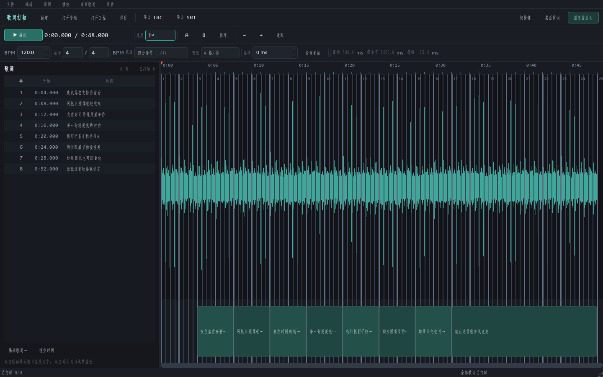
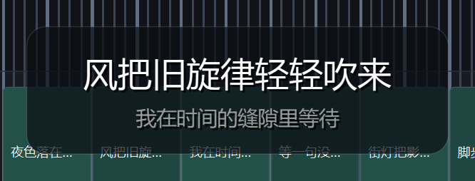
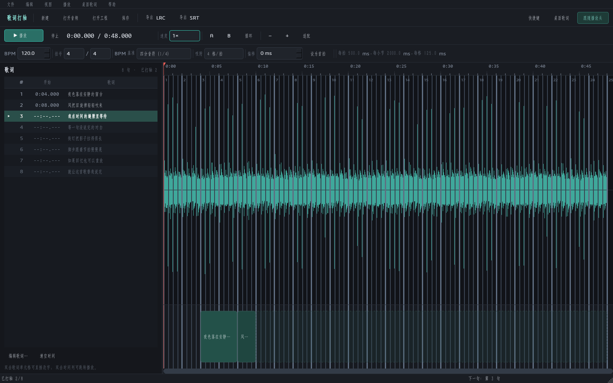

[](https://github.com/deepseek-ai/deepseek-harness)

> 本项目的代码、文档和安装包在开发过程中使用了
> [DeepSeek Harness（DSH）](https://github.com/deepseek-ai/deepseek-harness)
> 进行生成、整理和发布辅助。

[](https://github.com/Ling-Clouds/LyricsSubtitle/releases/latest)

**Windows 10/11 64 位 · 安装和卸载需要管理员权限 · 无需 Python**

# 歌词打轴 · LyricsSubtitle

把歌词按节拍对齐到音频，导出标准 LRC 与 SRT。适合做翻唱字幕、视频歌词、
音乐视频和网易云风格的时间轴。

- 版本：0.2.0
- 仓库：<https://github.com/Ling-Clouds/LyricsSubtitle>
- 许可证：MIT



## 产品简介

歌词打轴是一个面向歌曲、翻唱和视频字幕的桌面工具。它把“听歌 + 手动记时间”
变成“看着波形和节拍网格点几下”：

- 导入音频后自动生成波形
- 粘贴歌词，设置 BPM、拍号和吸附精度
- 在字幕轨上逐句点击，自动记录开始时间
- 随时试听、微调、撤销
- 一键导出 LRC 或 SRT
- 工程保存为 `.lysp`，下次继续编辑
- 桌面歌词预览：跟随播放显示当前句和下一句，可拖动、可换字体/字号/颜色

## 适合谁

- 给翻唱、原创歌曲做 LRC 歌词
- 给视频、MV、Vlog 做 SRT 字幕
- 需要把已有歌词快速对齐到音频的内容创作者
- 想要一个轻量、离线、无需上传音频的打轴工具的用户

## 5 分钟上手

1. **安装**：下载上面的 `LyricsSubtitle-Installer.exe`，按提示完成安装。
   安装程序会请求管理员权限（UAC）。浏览选择安装位置时，安装器会自动在所选
   目录后追加 `LyricsSubtitle` 文件夹，并在地址下方显示示例。
2. **打开音频**：点击「打开音频」，或把 mp3 / wav / flac / m4a 等文件拖到波形轨。
3. **输入歌词**：点击「编辑歌词…」，每行一句；如果还没有歌词，直接单击左侧空白歌词区域。
4. **设置网格**：填写 BPM，选择拍号和吸附精度。大多数 4/4 歌曲用默认值即可。
5. **逐句打轴**：在下方字幕轨上点击每一句的开始位置。每点一次自动进入下一句。
6. **试听微调**：按空格播放/暂停；拖动字幕块边界可调整上一句结束和下一句开始。
7. **导出**：点击「导出 LRC」或「导出 SRT」。需要继续编辑时先保存 `.lysp` 工程。

## 桌面歌词

桌面歌词会像音乐播放器一样悬浮在桌面上，随播放进度显示已打轴的当前句和下一句。

- 用工具栏「桌面歌词」按钮、菜单「桌面歌词 → 显示桌面歌词」，或
  `Ctrl+Shift+L` 开启。
- 直接按住歌词窗口拖动即可移动位置，不需要锁定。
- 在「桌面歌词 → 字体、字号与颜色…」中调整字体、字号和文字颜色。
- 位置、字体、字号、颜色和开关状态会自动保存，下次启动继续使用。
- 当前句使用主字体和颜色；下一句用较小的字号和较淡的颜色预览。



## 功能一览

- 三层时间轴：时间标尺、音频波形、字幕轨
- 无音频时波形轨显示加号：单击选择文件，或直接拖入音频
- 无歌词时单击左侧空白歌词区域即可打开编辑框
- BPM、拍号（分子/分母）、BPM 基准音符、每拍细分格数、首拍偏移
- 吸附支持「无」；关闭后播放头和悬停线可连续移动
- 字幕轨点击落轴，自动吸附网格；`Alt` + 点击临时关闭吸附
- 字幕块边界拖动，同时调整上一句结束和下一句开始（左右双箭头）
- 最后一句使用实心块 + 半透明虚线尾巴，点击可继续打轴
- 小节线 / 拍线 / 细分线使用 3px / 2px / 1px 的层级
- 撤销 / 重做、歌词列表、双击改错字、清空时间
- 播放 / 暂停、停止、0.5×–1.5× 变速、A-B 循环、标尺拖动平移、跟随播放头
- 桌面歌词：跟随播放、字体/字号/颜色、拖动位置、自动保存
- 导出 LRC（网易云等平台）与 SRT（视频剪辑软件）
- 工程保存为 `.lysp`，可随时继续编辑
- 内置示例工程，运行 `python app.py --demo` 可直接体验



## 详细使用

### 打开与定位

- 点击顶部标尺或波形区域：定位播放头（开启吸附时会吸附网格）。
- 按住左键在标尺上拖动：左右平移时间轴。
- 拖动播放头三角，或在波形区域按住拖动：连续拖动播放头。
- 空格播放/暂停；可以变速、设置 A/B 循环。
- 点击「停止」：播放中回到本次开始播放的位置；未播放时回到开头。
- 滚轮以鼠标位置为中心缩放；`Shift` + 滚轮左右平移；中键拖动平移。

### 编辑歌词

- 点击「编辑歌词…」或 `Ctrl+E` 打开编辑框。
- 每行一句，空行会被忽略。
- 没有歌词时，直接单击左侧歌词表格的空白区域也可以打开编辑框。
- 双击歌词单元格可以改错字。
- 已打轴的行可以用「清空时间」或右键菜单清除，不会删除文字。

### 设置网格

- `BPM`：歌曲速度。
- `拍号`：分子 / 分母，例如 4/4、3/4、6/8。
- `BPM 基准`：BPM 按哪个音符计数。默认四分音符；6/8 若 BPM 指八分音符速度，
  把它改成八分音符即可。
- `吸附`：每拍分成几格，例如 4 格/拍对应十六分音符；选择「无」关闭吸附。
- `偏移`：第一小节第一拍的实际时间。播放到首拍位置后点「设为首拍」，
  也可以手动输入毫秒。

### 打轴与微调

- 在波形下方的字幕轨上点击：点击位置成为当前句的开始时间，下一句的开始时间
  同时成为上一句的结束时间。
- 每点一次自动推进到下一句，左侧列表用 `▶` 标出当前待打轴句。
- 鼠标移到两个字幕块之间的边界（或第一块左边缘），指针变成左右双箭头，
  按住拖动即可调整边界。撤销用 `Ctrl+Z`。
- 最后一句还没有下一句时，结束时间暂定为音频末尾，用半透明尾巴表示持续到结尾。
  点击最后一句的实心块或尾巴可以继续给下一句打轴。

### 桌面歌词

- 开启后窗口置顶显示；主窗口最小化后仍会保留。
- 窗口没有边框，直接拖动即可移动；当前版本不提供锁定。
- 设置入口：菜单「桌面歌词 → 字体、字号与颜色…」。
- 如果不想显示，再次点击工具栏「桌面歌词」或按 `Ctrl+Shift+L`。
- 如果窗口被拖到屏幕外，可用菜单「桌面歌词 → 重置歌词位置」恢复。

## 快捷键

| 操作 | 快捷键 |
| --- | --- |
| 播放 / 暂停 | 空格 |
| 停止播放 | 点击播放栏「停止」 |
| 显示 / 隐藏桌面歌词 | `Ctrl+Shift+L` |
| 撤销 / 重做 | `Ctrl+Z` / `Ctrl+Y`（或 `Ctrl+Shift+Z`） |
| 打开音频 | `Ctrl+O` |
| 打开工程 | `Ctrl+Shift+O` |
| 保存工程 | `Ctrl+S` |
| 编辑歌词 | `Ctrl+E` |
| 放大 / 缩小 / 适配窗口 | `Ctrl+=` / `Ctrl+-` / `Ctrl+0` |
| 帮助 | `F1` |

鼠标：

| 操作 | 效果 |
| --- | --- |
| 单击波形轨中央加号 | 选择音频文件 |
| 把音频文件拖到波形轨 | 导入 / 替换音频 |
| 单击空白的歌词区域 | 打开歌词编辑框 |
| 点击标尺 / 波形 | 定位播放头 |
| 按住左键拖动标尺 | 左右平移时间轴 |
| 拖动播放头三角 / 在波形上拖动 | 拖动播放头 |
| 点击字幕轨空白 | 给当前句落轴 |
| 拖动两个字幕块之间的边界 | 调整下一句开始（双箭头） |
| 点击最后一句的实心块或尾巴 | 继续打下一句 |
| 双击字幕块 / 时间列 | 从该句开始播放 |
| 滚轮 | 以鼠标位置为中心缩放 |
| `Shift` + 滚轮 | 左右平移 |
| 中键拖动 | 平移 |
| `Alt` + 点击 | 落轴时临时关闭吸附 |
| 拖动桌面歌词窗口 | 移动歌词位置 |

## 导出格式

### LRC

```text
[00:04.00]夜色落在安静的窗台
[00:08.00]风把旧旋律轻轻吹来
```

- 只使用每句的开始时间，按 10ms（两位小数）四舍五入。
- 不写 `ti` / `ar` / `al` 等标签，不做双语。
- UTF-8、LF 换行。

### SRT

```text
1
00:00:04,000 --> 00:00:08,000
夜色落在安静的窗台

2
00:00:08,000 --> 00:00:12,000
风把旧旋律轻轻吹来
```

- 每句的结束时间等于下一句的开始时间；最后一句结束于音频末尾。
- 句与句之间不留 gap，不自动拆行。
- UTF-8 无 BOM、LF 换行。
- 未打轴或歌词为空的句子会跳过，并在状态栏提示跳过数量。

## 工程文件

工程保存为 `.lysp` 文件，包含：

- 音频绝对路径
- 音频时长
- BPM、拍号、BPM 基准、细分格数、首拍偏移、是否启用吸附
- 每句歌词的文字与开始时间

打开工程时如果音频被移动，会提示重新定位。旧版 `.json` 工程仍然可以通过
打开对话框选择并打开。

## 从源码运行

普通用户建议直接使用安装包。以下内容面向开发或自行修改。

环境要求：

- Windows 10/11 64 位
- Python 3.10 及以上
- PySide6、numpy
- FFmpeg：源码运行时如果没有系统 ffmpeg，也可以安装 `imageio-ffmpeg`；
  安装包版本已内置 LGPL 版 FFmpeg。

```bat
python -m pip install -r requirements.txt
python app.py
```

带示例音频和歌词启动：

```bat
python app.py --demo
```

也可以直接双击 `run.bat`。

## 构建安装包

应用使用 PyInstaller 打包；安装器和卸载器使用 Windows 自带的
.NET Framework 4.8 C# 编译器（`csc.exe`）编译，不需要额外安装 Inno Setup、
NSIS 等工具。应用和 FFmpeg 均为 64 位。

1. 准备 **LGPL 版 FFmpeg shared build**（推荐
   [BtbN FFmpeg-Builds](https://github.com/BtbN/FFmpeg-Builds) 的
   `win64-lgpl-shared` 包），把 `ffmpeg.exe` 和全部 `.dll` 放到 `bin/`。
   不要使用带 `--enable-gpl` 的构建。
2. 安装打包依赖：

   ```bat
   python -m pip install -r requirements-build.txt
   ```

3. 只构建应用：

   ```bat
   build_exe.bat
   ```

   产物：`dist\LyricsSubtitle\LyricsSubtitle.exe`（onedir，必须保留整个文件夹）。

4. 构建完整安装程序：

   ```bat
   build_installer.bat
   ```

   产物：`dist\LyricsSubtitle-Installer.exe`。安装器和卸载器都需要管理员权限。

说明：

- `dist/`、`build/`、`bin/`、`.venv-build/`、`.pyinstaller-cache/` 都不会进入
  Git 仓库。
- 应用自检：

  ```bat
  dist\LyricsSubtitle\LyricsSubtitle.exe --self-test
  ```

  正常时返回码为 0，并在 `%TEMP%\lyrics_subtitle_selftest.txt` 写入结果。

## 常见问题

**安装或卸载时提示需要管理员权限**

安装器和卸载器的 manifest 都声明了 `requireAdministrator`，Windows 会弹出 UAC。
请允许管理员权限；这是安装和卸载正常工作的前提。

**SmartScreen 提示未知发布者**

安装程序未做代码签名。确认来自本仓库 Releases 后，选择“更多信息 → 仍要运行”。

**没有波形 / 提示找不到 ffmpeg**

安装包版本自带 FFmpeg；如果使用源码运行，请安装 ffmpeg 并加入 `PATH`，或者：

```bat
python -m pip install imageio-ffmpeg
```

**音频能播放但没有波形**

说明 ffmpeg 解码失败但播放器仍能播放。打轴和导出可以继续，只是看不到波形。
在错误对话框的「详细信息」里可以看到 ffmpeg 的输出。

**桌面歌词窗口不见了**

按 `Ctrl+Shift+L` 或点击工具栏「桌面歌词」重新显示；如果位置在屏幕外，
使用菜单「桌面歌词 → 重置歌词位置」。

**桌面歌词没有跟随播放**

桌面歌词只显示已打轴的句子。请先给歌词落轴，并确认正在播放或定位到对应时间。

**如何卸载**

Windows 设置 → 应用 → 歌词打轴；或开始菜单中的「卸载 歌词打轴」。
卸载需要管理员权限。

## 许可证

- 本项目源代码使用 **MIT License**，见 [LICENSE](LICENSE)。
- 安装包附带第三方组件，完整声明见
  [THIRD_PARTY_NOTICES.md](THIRD_PARTY_NOTICES.md)，许可证文本在
  [licenses/](licenses/) 目录。
- FFmpeg：LGPL-3.0（shared build，未启用 `--enable-gpl`），
  对应源码与构建脚本见第三方声明。
- Qt 6 / PySide6：LGPL-3.0，以动态库形式分发，用户可替换安装目录中的共享库。
- NumPy：BSD-3-Clause；Python：PSF-2.0。

如果你重新分发本软件或其修改版本，请保留 `LICENSE`、`THIRD_PARTY_NOTICES.md`
和 `licenses/` 目录，并遵守 FFmpeg、Qt/PySide6 等组件的许可证。
