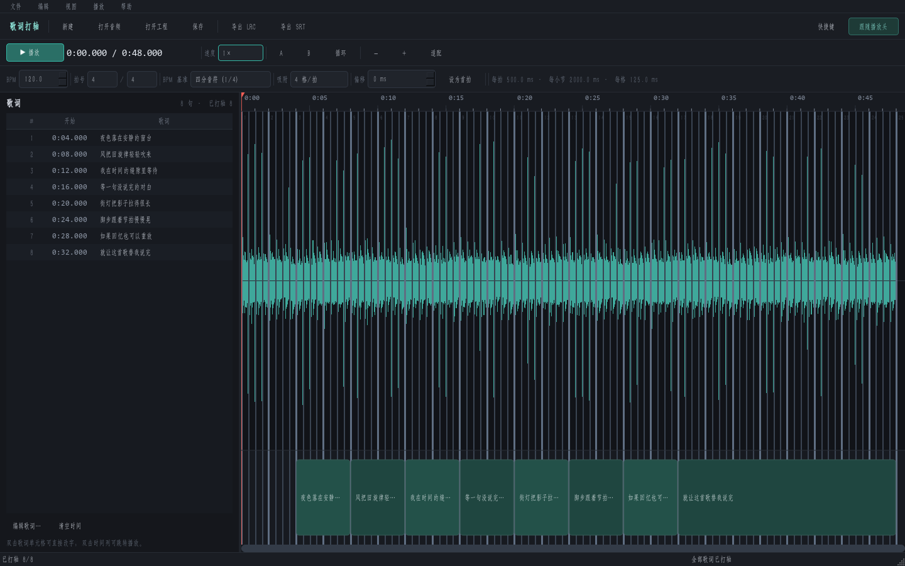
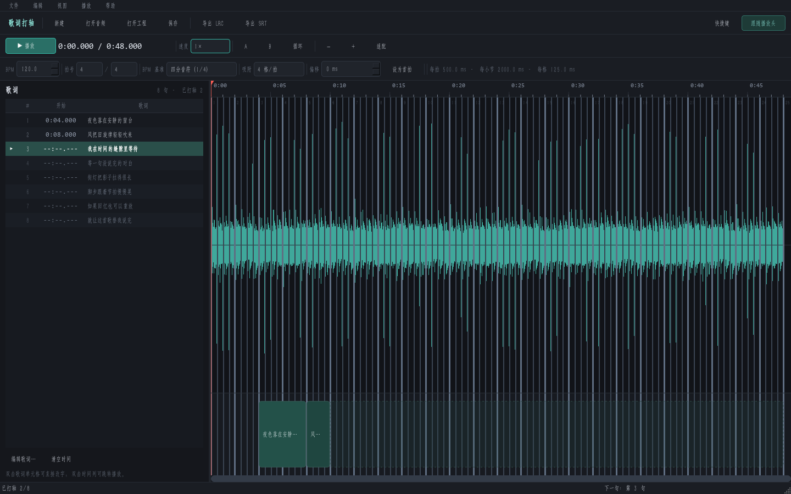
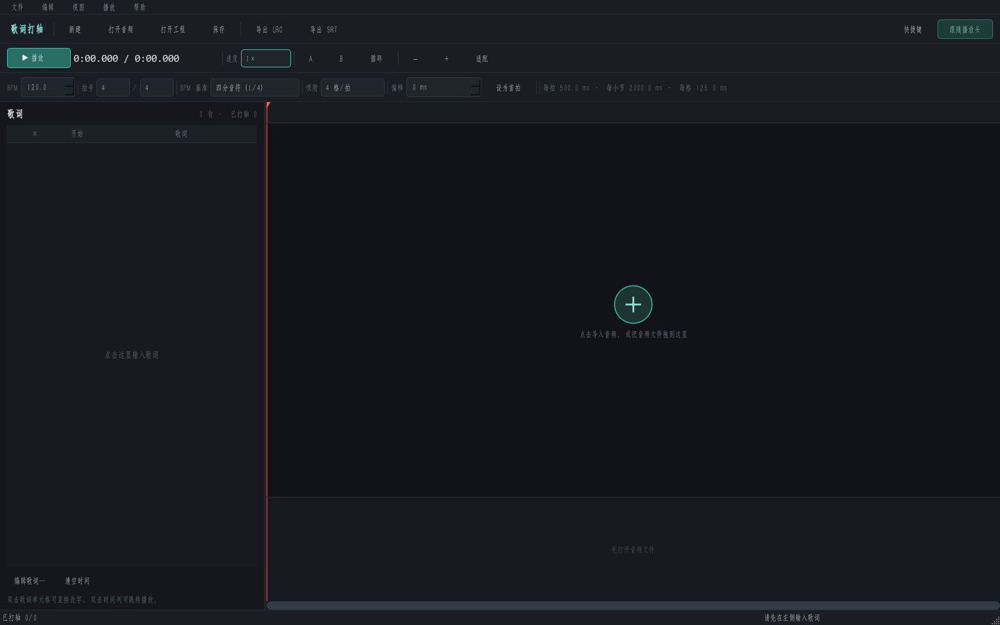

# 歌词打轴 · LyricsSubtitle

一个用 Python + PySide6 写的桌面工具：导入音频和歌词，按 BPM 网格逐句点击打轴，导出标准 LRC 与 SRT。

- 仓库：<https://github.com/Ling-Clouds/LyricsSubtitle>
- 版本：0.1.0
- 许可证：MIT（第三方组件声明见下文）

## 安装（推荐）

最推荐直接使用安装程序，不需要安装 Python，也不需要下载源码。适用于
**Windows 10/11 64 位**。

1. 打开 [Releases](https://github.com/Ling-Clouds/LyricsSubtitle/releases/latest)，下载
   **`LyricsSubtitle-Installer.exe`**。
2. 双击运行安装程序，选择安装位置（默认
   `%LOCALAPPDATA%\Programs\LyricsSubtitle`），阅读并同意许可证与第三方组件声明。
3. 安装完成后从桌面快捷方式或开始菜单启动「歌词打轴」。
4. 卸载：Windows 设置 → 应用 → 歌词打轴；或开始菜单中的「卸载 歌词打轴」。

安装程序按用户安装，不需要管理员权限。安装包已经包含运行所需的
Qt/PySide6、Python 运行时和 FFmpeg，不会修改系统环境变量。

> 安装程序尚未做代码签名，Windows SmartScreen 可能提示“未知发布者”。
> 确认文件来自本仓库 Releases 后，可选择“更多信息 → 仍要运行”。



## 功能

- 时间轴分为三层：时间标尺、音频波形、字幕轨
- 没有音频时，波形轨中央显示加号：单击选择文件，或把音频文件直接拖进波形轨
- 没有歌词时，单击左侧歌词区域即可打开编辑框
- BPM、拍号（分子/分母）、BPM 基准音符、每拍细分格数、首拍偏移
- 吸附支持「无」：关闭后播放头和悬停指示线可以连续移动；开启时两者都吸附网格
- 在字幕轨上点击即可给当前句落轴，自动吸附到最近的网格线
- 按住 `Alt` 点击时临时关闭落轴吸附，可自由放置
- 最后一句用「实心块 + 半透明虚线尾巴」表示：实心块是本句，尾巴表示它会持续到下一句
- 在两个字幕块之间的边界上拖动，可同时调整上一句结束和下一句开始；鼠标会变成左右双箭头
- 小节线 / 拍线 / 细分线使用 3px / 2px / 1px 的粗细和递进亮度
- 撤销 / 重做、歌词列表、双击单元格改错字、清空时间
- 播放 / 暂停、0.5×–1.5× 变速、A-B 循环、拖标尺平移、播放时跟随
- 导出 LRC（网易云等平台）与 SRT（视频剪辑软件）
- 工程保存为 `.lysp` 文件，可随时继续编辑
- 内置示例工程，运行 `python app.py --demo` 可直接体验





## 使用方法

1. **打开音频**：没有音频时，单击波形轨中央的加号，或把 mp3/wav/flac/m4a 等
   音频文件直接拖到波形轨上。也可以用工具栏「打开音频」。
   支持 mp3、wav、flac、m4a、aac、ogg 等（播放取决于 Qt 后端；波形由 ffmpeg 解码）。
2. **编辑歌词**：没有歌词时，直接单击左侧空白的歌词区域会打开编辑框。
   之后可以点「编辑歌词…」，或双击歌词单元格改错字。每行一句，空行会被忽略。
3. **设置网格**：
   - `BPM`：歌曲速度。
   - `拍号`：分子 / 分母，例如 4/4、3/4、6/8。
   - `BPM 基准`：BPM 是按哪个音符计数的。默认四分音符；如果 6/8 的
     BPM 指的是八分音符速度，把它改成八分音符即可。
   - `吸附`：每拍分成几格，例如 4 格/拍对应十六分音符；选择「无」关闭吸附。
   - `偏移`：第一小节第一拍的实际时间。播放到首拍位置后点「设为首拍」，
     也可以手动输入毫秒。
4. **播放和定位**：
   - 点击顶部标尺或波形区域：定位播放头（开启吸附时会吸附网格）。
   - 按住左键在标尺上拖动：左右平移时间轴。
   - 拖动播放头三角，或在波形区域按住拖动：连续拖动播放头。
   - 空格播放/暂停；可以变速、设置 A/B 循环。
5. **打轴**：在波形下方的字幕轨上点击。点击位置吸附到最近网格线，
   作为当前句的开始时间；下一句的开始时间同时成为上一句的结束时间。
   每点一次自动推进到下一句，左侧列表用 `▶` 标出当前待打轴句。
6. **微调**：把鼠标移到两个字幕块之间的边界（或第一块左边缘），指针变成
   左右双箭头，按住拖动即可调整边界。撤销用 `Ctrl+Z`。
7. **导出**：工具栏「导出 LRC」或「导出 SRT」。导出前建议先保存工程。

### 最后一句为什么有半透明尾巴？

在还没有打下一句时，最后一句的结束时间暂定为音频末尾，但直接画到末尾会
遮住后面整条轨道。因此实心块只画一小段，后面用半透明虚线尾巴表示
「这一句会一直持续到下一句」。点击最后一句的实心块或尾巴都会继续给下一句
打轴；要调整最后一句的开始时间，拖动它左侧的块边界即可。

### 网格线的层级

- 小节线：3px，最亮
- 拍线：2px，中等
- 细分线：1px，最暗

缩放较小时细分线会自动省略，只保留拍线和小节线。

## 从源码运行

适合开发或自行修改。普通用户建议直接使用上面的安装程序。

环境要求：

- Windows 10/11 64 位
- Python 3.10 及以上
- PySide6、numpy
- FFmpeg：源码运行时如果没有系统 ffmpeg，也可以安装 `imageio-ffmpeg`；
  安装包版本已内置 FFmpeg。

```bat
python -m pip install -r requirements.txt
python app.py
```

带示例音频和歌词启动：

```bat
python app.py --demo
```

也可以直接双击 `run.bat`。

## 导出格式

### LRC

```text
[00:04.00]夜色落在安静的窗台
[00:08.00]风把旧旋律轻轻吹来
```

- 只使用每句的开始时间，按 10ms（两位小数）四舍五入。
- 不写 `ti` / `ar` / `al` 等标签，不做双语。
- UTF-8、LF 换行。

### SRT

```text
1
00:00:04,000 --> 00:00:08,000
夜色落在安静的窗台

2
00:00:08,000 --> 00:00:12,000
风把旧旋律轻轻吹来
```

- 每句的结束时间等于下一句的开始时间；最后一句结束于音频末尾。
- 句与句之间不留 gap，不自动拆行。
- UTF-8 无 BOM、LF 换行。
- 未打轴或歌词为空的句子会跳过，并在状态栏提示跳过数量。

## 快捷键

| 操作 | 快捷键 |
| --- | --- |
| 播放 / 暂停 | 空格 |
| 撤销 / 重做 | `Ctrl+Z` / `Ctrl+Y`（或 `Ctrl+Shift+Z`） |
| 打开音频 | `Ctrl+O` |
| 打开工程 | `Ctrl+Shift+O` |
| 保存工程 | `Ctrl+S` |
| 编辑歌词 | `Ctrl+E` |
| 放大 / 缩小 / 适配窗口 | `Ctrl+=` / `Ctrl+-` / `Ctrl+0` |
| 帮助 | `F1` |

鼠标：

| 操作 | 效果 |
| --- | --- |
| 单击波形轨中央加号 | 选择音频文件 |
| 把音频文件拖到波形轨 | 导入 / 替换音频 |
| 单击空白的歌词区域 | 打开歌词编辑框 |
| 点击标尺 / 波形 | 定位播放头 |
| 按住左键拖动标尺 | 左右平移时间轴 |
| 拖动播放头三角 / 在波形上拖动 | 拖动播放头 |
| 点击字幕轨空白 | 给当前句落轴 |
| 拖动两个字幕块之间的边界 | 调整下一句开始（双箭头） |
| 点击最后一句的实心块或尾巴 | 继续打下一句 |
| 双击字幕块 / 时间列 | 从该句开始播放 |
| 滚轮 | 以鼠标位置为中心缩放 |
| `Shift` + 滚轮 | 左右平移 |
| 中键拖动 | 平移 |
| `Alt` + 点击 | 落轴时临时关闭吸附 |

## 工程文件

工程保存为 `.lysp` 文件，包含：

- 音频绝对路径
- 音频时长
- BPM、拍号、BPM 基准、细分格数、首拍偏移、是否启用吸附
- 每句歌词的文字与开始时间

打开工程时如果音频被移动，会提示重新定位。旧版 `.json` 工程仍然可以通过
打开对话框选择并打开。

## 开发与打包

目录结构：

```text
app.py                      入口
lyrics_subtitle/
  core.py                   数据模型、网格计算、时间格式
  exporters.py              LRC / SRT 生成
  audio.py                  ffmpeg 解码与波形峰值
  history.py                撤销栈
  demo.py                   示例工程
  ui/
    main_window.py          主窗口与业务串联
    timeline.py             时间轴绘制与鼠标交互
    panel.py                歌词列表
    player.py               QtMultimedia 播放封装
    theme.py                深色主题
installer/
  Installer.cs             原生 C# 安装程序界面与安装逻辑
  Uninstaller.cs           原生 C# 卸载程序
  make_payload.py          生成安装负载
assets/
  icon.ico / icon.png       应用图标
tests/                      单元测试与离屏 UI 冒烟测试
tools/                      截图、播放冒烟等开发脚本
LyricsSubtitle.spec         应用 PyInstaller 打包配置
build_exe.bat               只构建应用
build_installer.bat         构建应用 + 卸载程序 + 安装程序
requirements.txt            运行依赖
requirements-build.txt      打包依赖
```

运行测试：

```bat
python -m unittest discover -s tests -v
```

### 构建应用和安装程序

应用使用 PyInstaller 打包；安装器和卸载器使用 Windows 自带的
.NET Framework 4.8 C# 编译器（`csc.exe`）编译，不需要额外安装 Inno Setup、
NSIS 等工具。应用和 FFmpeg 均为 64 位。

1. 准备 **LGPL 版 FFmpeg shared build**（推荐
   [BtbN FFmpeg-Builds](https://github.com/BtbN/FFmpeg-Builds) 的
   `win64-lgpl-shared` 包），把 `ffmpeg.exe` 和全部 `.dll` 放到 `bin/`。
   不要使用带 `--enable-gpl` 的构建，以免与项目的 MIT 许可证产生冲突。
2. 安装打包依赖：

   ```bat
   python -m pip install -r requirements-build.txt
   ```

3. 只构建应用：

   ```bat
   build_exe.bat
   ```

   产物：`dist\LyricsSubtitle\LyricsSubtitle.exe`（onedir，必须保留整个文件夹）。

4. 构建完整安装程序：

   ```bat
   build_installer.bat
   ```

   产物：`dist\LyricsSubtitle-Installer.exe`。

说明：

- 安装程序会把 `dist\LyricsSubtitle` 打包成单文件安装器，安装到用户目录，
  不需要管理员权限。
- `dist/`、`build/`、`bin/`、`.venv-build/`、`.pyinstaller-cache/` 都不会进入
  Git 仓库。
- 应用自检：

  ```bat
  dist\LyricsSubtitle\LyricsSubtitle.exe --self-test
  ```

  正常时返回码为 0，并在 `%TEMP%\lyrics_subtitle_selftest.txt` 写入结果。

## 常见问题

**SmartScreen 提示未知发布者**

安装程序未做代码签名。确认来自本仓库 Releases 后，选择“更多信息 → 仍要运行”。

**没有波形 / 提示找不到 ffmpeg**

安装包版本自带 FFmpeg；如果使用源码运行，请安装 ffmpeg 并加入 `PATH`，或者：

```bat
python -m pip install imageio-ffmpeg
```

**音频能播放但没有波形**

说明 ffmpeg 解码失败但播放器仍能播放。打轴和导出可以继续，只是看不到波形。
在错误对话框的「详细信息」里可以看到 ffmpeg 的输出。

**m4a 无法播放**

波形由 ffmpeg 解码，通常没问题；播放依赖 Qt 的多媒体后端。如果播放失败，
可以把音频转成 wav/mp3 再试。

**打轴时提示必须晚于上一句**

当前句的开始时间必须晚于上一句；如果想重新排列，先用「清空时间」或
`Ctrl+Z` 撤销，再按顺序重新打。

**为什么拖动标尺是平移，不是拖播放头？**

标尺空白处按住拖动是平移时间轴；要拖播放头，请抓住顶部红色三角，
或在波形区域按住拖动。单击标尺仍然会定位播放头。

**导出的 SRT 在某个剪辑软件里显示乱码**

本工具输出 UTF-8 无 BOM。少数老软件只认 GBK 或带 BOM 的 UTF-8，
可以先用记事本另存为对应编码再导入。

**如何卸载**

Windows 设置 → 应用 → 歌词打轴；或开始菜单中的「卸载 歌词打轴」。

## 许可证

- 本项目源代码使用 **MIT License**，见 [LICENSE](LICENSE)。
- 安装包附带第三方组件，完整声明见
  [THIRD_PARTY_NOTICES.md](THIRD_PARTY_NOTICES.md)，许可证文本在
  [licenses/](licenses/) 目录。
- FFmpeg：LGPL-3.0（shared build，未启用 `--enable-gpl`），
  对应源码与构建脚本见第三方声明。
- Qt 6 / PySide6：LGPL-3.0，以动态库形式分发，用户可替换安装目录中的共享库。
- NumPy：BSD-3-Clause；Python：PSF-2.0。

如果你重新分发本软件或其修改版本，请保留 `LICENSE`、`THIRD_PARTY_NOTICES.md`
和 `licenses/` 目录，并遵守 FFmpeg、Qt/PySide6 等组件的许可证。
